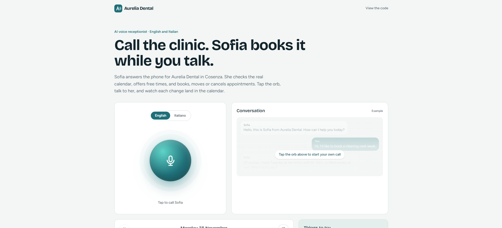
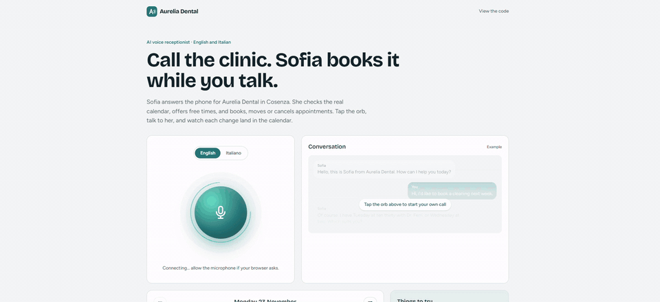
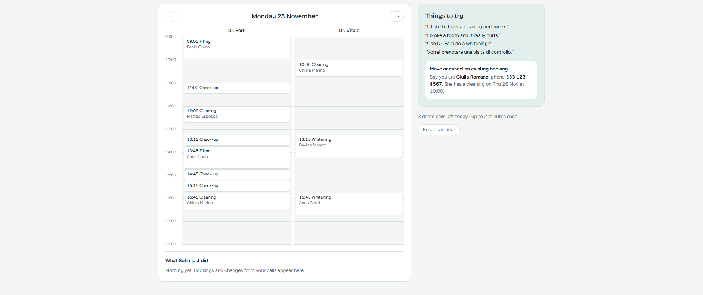
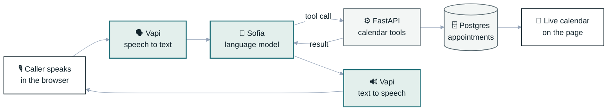

# AI Voice Receptionist

An AI receptionist that answers calls for a dental clinic, in English and Italian. Callers book, move and cancel appointments by voice, and every change shows up in a live calendar while they talk. Built with Vapi for the voice, a FastAPI backend for the calendar tools, and a Next.js frontend.

The example business is Aurelia Dental, a fictional clinic in Cosenza. The agent is called Sofia.

**Live demo:** https://aurelia-dental-voice-receptionist.vercel.app



## Demo



| A live call | The calendar updating |
|---|---|
|  |  |

## What it does

- Answers calls in the browser, with separate English and Italian lines
- Books new appointments: asks for the treatment, checks both dentists' calendars, offers two or three real times, and confirms
- Finds a caller's booking by phone number, and moves or cancels it
- Mentions the 30 euro fee for cancellations within 24 hours
- Offers today's earliest emergency slot for pain or a broken tooth, and points serious cases to 112
- Refuses what the clinic doesn't offer, for example whitening with a dentist who doesn't do it
- Shows the conversation and the calendar live on the page, with every booking, move and cancellation highlighted

Each visitor gets a private copy of the clinic calendar, partly booked, with a sample patient to try rescheduling. Visitors never see each other's bookings.

## How it works



**The model only talks, the backend decides.** The language model can't touch the database. It can only call five tools, and the backend checks every request against the clinic rules: opening hours, appointment length, which dentist does which treatment, the 4-week booking window, and overlapping appointments. A rejected request comes back as a short message the agent explains to the caller.

**One endpoint for all tools.** Vapi sends every tool call to `POST /api/vapi/tools` with a shared secret in the `x-vapi-secret` header. The backend runs each call and answers in Vapi's format, always with HTTP 200, so errors reach the agent instead of breaking the call.

**Which calendar.** When the page starts a call, it passes the visitor's ID to Vapi as call metadata. Vapi includes it with every tool call, and the backend uses it to pick that visitor's calendar.

**Live calendar.** During a call, the page refreshes the calendar every few seconds. Appointments the agent booked or moved pop in and glow, and if the agent changes something on another day, the calendar jumps to it.

## Tools

| Tool | What it does |
|---|---|
| `check_availability` | Free times for a treatment, on a given day or as soon as possible, spread out to give real choices |
| `book_appointment` | Books one of those times after the caller confirms |
| `find_appointments` | The caller's upcoming appointments, by phone number |
| `reschedule_appointment` | Moves an appointment to a new free time |
| `cancel_appointment` | Cancels, and flags late cancellations |

The prompt, tool definitions and assistant settings are in [`vapi/`](vapi/).

## Demo limits

With `DEMO_MODE=true`, each visitor can make 3 calls a day of up to 2 minutes, with 40 calls a day across the whole site. All three numbers come from environment variables. The page checks the limit with the backend before starting a call, so no voice minutes are used once a visitor is over the limit. The Vapi public key only works from the site's address and only for the two assistants.

## Stack

- **Voice:** Vapi (speech recognition, voice, call handling), with Deepgram Nova 3 for transcription
- **Model:** OpenAI
- **Backend:** FastAPI, SQLAlchemy, Alembic, Pydantic
- **Database:** Postgres on Neon
- **Frontend:** Next.js 16, TypeScript, Tailwind CSS v4, Vapi Web SDK, types generated from the OpenAPI spec
- **Hosting:** Vercel for both apps, in Frankfurt next to the database

## Run locally

You need Python 3.12 or later, Node.js 20 or later, Docker, and a Vapi account.

Start the database:

```bash
docker compose up -d
```

Backend:

```bash
cd backend
python -m venv .venv
.venv\Scripts\activate          # on macOS or Linux: source .venv/bin/activate
pip install -r requirements.txt
cp .env.example .env            # then set VAPI_SERVER_SECRET
alembic upgrade head
uvicorn app.main:app --reload --port 8000
```

Test the tools without Vapi:

```bash
python -m scripts.new_visitor
python -m scripts.try_tools VISITOR_ID
```

Frontend, in a second terminal:

```bash
cd frontend
npm install
cp .env.example .env.local      # then add the Vapi public key and assistant IDs
npm run dev
```

Vapi needs a public HTTPS address to reach the tools, so point the tools at the deployed backend, or forward them to your machine with the Vapi CLI or a tunnel. See [`vapi/README.md`](vapi/README.md) for the assistant setup.

Open http://localhost:3000 for the app, and http://localhost:8000/api/docs for the API docs.

## Project structure

```
backend/
  app/
    clinic/         opening hours, dentists, treatments and rules
    services/
      calendar/     free slots, booking, rescheduling, cancelling
      seed.py       starting calendar for each visitor
      limits.py     daily demo limits
    vapi/           tool endpoint: secret check, parsing, the five tools
    routers/        session, calendar, calls, demo reset, Vapi tools
    models/         visitors, appointments, call sessions
  alembic/          migrations
  scripts/          local test scripts
frontend/
  app/              the page
  components/       voice orb and call card, transcript, live calendar, landing sections
  lib/              typed API client, call hook, formatting
vapi/               system prompt, tool definitions, assistant setup
docker-compose.yml
```